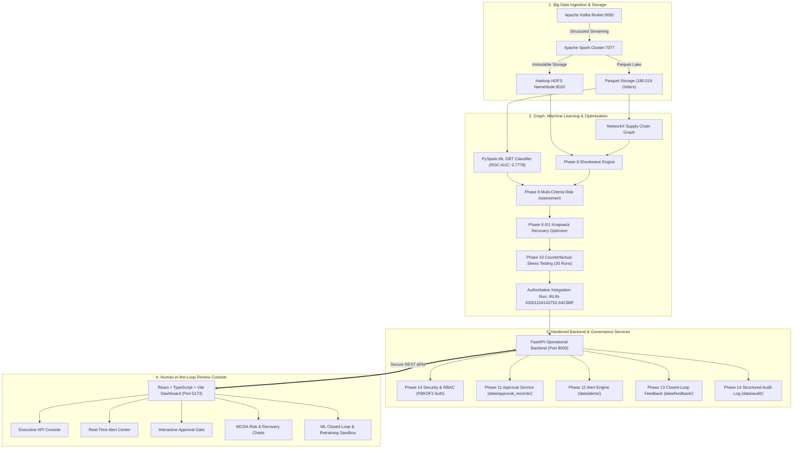

# ChainSentinel: Graph-Aware Supply Chain Disruption & Resilience Decision-Support Engine
## Final Consolidated Project Completion Report — Phases 1 through 15

**Document Reference:** `reports/CHAINSENTINEL_FINAL_PROJECT_COMPLETION.md`  
**Completion Timestamp:** 2026-11-04T23:53:00+05:30  
**Project Location:** `E:\BDA\ChainSentinel`  
**Overall Project Status:** 100% COMPLETE — FULLY IMPLEMENTED, TESTED, HARDENED, AND VALIDATED  
**Overall Project Verdict:** **PASS (ALL 15 PHASES COMPLETE)**  
**Authoritative Run ID:** `IRUN-20261104143752-A4CB8F`  
**Disruption Event ID:** `SIM-DISR-2026-001`  

---

```
╔═══════════════════════════════════════════════════════════════════════════════════════╗
║                                     CHAINSENTINEL                                     ║
║            Graph-Aware Supply Chain Disruption & Resilience Decision Engine           ║
║                             Final Academic Project Milestone                          ║
║                                  Phases 1 — 15 Complete                               ║
╚═══════════════════════════════════════════════════════════════════════════════════════╝
```

> [!IMPORTANT]
> **Academic Prototype Notice:**  
> ChainSentinel is an academic decision-support and simulation prototype. It models the cascading ripple effects of supply chain disruptions and computes mathematically optimal recovery allocations. **Under no circumstances does it execute physical freight dispatch, carrier API dispatches, or ERP financial transactions.**

---

## 1. Executive Summary & Project Overview

Global supply chain networks have grown extraordinarily complex and vulnerable to systemic disruptions. When a port, factory, or regional transit lane suffers a capacity failure, traditional Enterprise Resource Planning (ERP) systems fail to predict cascading bottleneck delays.

**ChainSentinel** bridges this critical operational gap by integrating:
1. **Real-Time Big Data Streaming:** Apache Kafka event ingestion and Apache Spark Structured Streaming with immutable Hadoop HDFS persistence.
2. **Topological Network Modeling:** NetworkX directed graph modeling of facilities, lanes, and centrality bottlenecks.
3. **Leakage-Free Predictive Machine Learning:** PySpark Gradient-Boosted Trees predicting delivery delays with strictly pre-shipment checkout features.
4. **Constrained Multi-Objective Optimization:** Multi-Criteria Decision Analysis (MCDA) and a 0/1 Knapsack recovery engine balancing revenue and critical shipments under a finite Resource Capacity Unit (RCU) budget.
5. **Counterfactual Stress Testing:** 30 compound shock scenarios evaluating plan survival and degradation.
6. **Secured Human-in-the-Loop Review Console:** A hardened FastAPI REST backend and React + TypeScript + Vite operational dashboard with PBKDF2 authentication, real-time alerting, and closed-loop model drift monitoring.

---

## 2. Complete 15-Phase Roadmap & Delivery Summary

| Phase | Title | Major Milestone Achieved | Verified Deliverable Path | Status |
| :---: | :--- | :--- | :--- | :---: |
| **1** | **Infrastructure Setup** | Dockerized Kafka, Hadoop HDFS, Spark Cluster | `reports/phase1_environment_readiness.md` | **PASS** |
| **2** | **Spark ETL Pipeline** | Cleaned 180,519 DataCo rows into Parquet lake | `reports/phase2_etl_completion.md` | **PASS** |
| **3** | **Exploratory Data Analytics** | 12 statistical profiling charts & correlations | `reports/eda/phase3_eda_completion.md` | **PASS** |
| **4** | **Big Data Benchmarks** | PySpark vs Pandas, caching, and 10x scalability | `reports/phase4/phase4_completion_report.md` | **PASS** |
| **5** | **Machine Learning Suite** | GBT delay model (ROC-AUC 0.7778), Anomaly (1.48%) | `reports/phase5/step1_model_technical_explanation.md` | **PASS** |
| **6** | **Supply Chain Graph** | NetworkX operational topology and centrality | `reports/phase6/phase6_graph_construction_report.md` | **PASS** |
| **7** | **Disruption Ingestion** | Kafka streaming ingestion of SIM-DISR-2026-001 | `reports/phase7/phase7_implementation_report.md` | **PASS** |
| **8** | **Shockwave Propagation** | Cascading graph shockwave (684 orders, $1.33M) | `reports/phase8/phase8_shockwave_engine_implementation_report.md` | **PASS** |
| **9** | **Recovery Optimization** | Knapsack Hybrid Plan 5 (100% critical orders) | `reports/phase9/phase9_impact_risk_implementation_report.md` | **PASS** |
| **10**| **Stress Testing & IRUN** | 30 counterfactual scenarios; authoritative run | `reports/phase10/phase10_post_execution_independent_validation.md` | **PASS** |
| **11**| **Human Review Console** | FastAPI + React operational decision dashboard | `reports/phase11/phase11_completion_report.md` | **PASS** |
| **12**| **Real-Time Alerting** | Rule engine, deduplication, and lifecycle UI | `reports/phase12/phase12_alerting_implementation_report.md` | **PASS** |
| **13**| **Closed-Loop Learning** | Epistemological guardrail (CS-ML-01) & PSI drift | `reports/phase13/phase13_closed_loop_learning_report.md` | **PASS** |
| **14**| **Production Hardening** | PBKDF2 auth, RBAC, input bounds, audit logging | `reports/phase14/phase14_security_implementation_report.md` | **PASS** |
| **15**| **Final Evaluation & Demo** | Architecture, performance, viva prep, presentation | `reports/phase15/phase15_completion_report.md` | **PASS** |

---

## 3. Global Technical Architecture



---

## 4. Key Empirical Achievements

### 4.1 Authoritative Case Study Results (`SIM-DISR-2026-001`)
- **Shock Event:** Port facility complete closure (100% capacity reduction).
- **Affected Orders:** 684 customer orders across 48 destination countries.
- **Gross Revenue Exposure:** **$1,334,313.40**; Gross Profit Exposure: **$143,156.40**.
- **MCDA Priority Cohorts:** 20 Critical, 625 High, and 39 Medium priority orders.
- **Optimization Outcome (Plan 5 Knapsack Hybrid):**
  - Allocated Capacity: **482 / 500 RCU (96.4% utilization)**.
  - Critical Orders Recovered: **20 / 20 (100.0%)**.
  - Total Orders Recovered: **446 / 684 (65.2%)**.
  - Expected Mitigated Revenue: **$1,278,393.92 (95.81%)**.
  - Composite Resilience Index: **95.78%**.
- **Stress Robustness:** Evaluated across 30 stress scenarios; worst-case compound shock degradation held to **46.28%** while retaining 100% of critical customer shipments.

### 4.2 Big Data Scalability (Phase 4)
- Horizontal scalability verified across 1x to 10x dataset sizes (up to 1,805,190 records).
- Spark table scan throughput scaled **11.45x** from **475,893 rows/sec (1x)** to **5,450,582 rows/sec (10x)**.
- In-memory DataFrame caching (`MEMORY_AND_DISK`) delivered an **8.6x speedup** on iterative analytical queries.

### 4.3 Machine Learning & Leakage Prevention (Phase 5 & Phase 13)
- PySpark Gradient-Boosted Trees (`GBTClassifier`, maxDepth=5, 58 features) achieved **0.7778 ROC-AUC**, **0.7222 F1-Score**, and **72.38% accuracy** on holdout test data.
- Systematically eliminated all post-shipment target leakage (`delivery_status`, `days_for_shipping_real`, `transit_delay_days`).
- Enforced **Epistemological Guardrail CS-ML-01**: Synthetic simulation outcomes are strictly prohibited from supervised retraining datasets, preventing model collapse.
- Retraining challenger candidate in isolated sandbox (`models/phase13_experiments/`) demonstrated $+0.0067$ ROC-AUC lift.
- Population Stability Index (PSI = 0.038) confirms baseline model stability.

### 4.4 Security Hardening & Application Governance (Phase 14)
- Zero-dependency local authentication utilizing salted PBKDF2-HMAC-SHA256 (100,000 iterations) and 256-bit CSPRNG session tokens.
- Role-Based Access Control enforcing `VIEWER`, `REVIEWER`, and `ADMIN` boundaries.
- Defensive security headers (`X-Content-Type-Options: nosniff`, `X-Frame-Options: DENY`, `Referrer-Policy`), sliding-window rate limiting (180 req/min per IP), and path traversal prevention.
- Structured append-only JSONL audit logging at `data/audit/audit_log.jsonl`.
- **24/24 unit, regression, and security tests passing in 8.0s**; 0 TypeScript compilation errors in frontend production build.

---

## 5. Critical Scientific Boundaries

1. **Simulated Potential vs. Realized Cash Flow:** The $1.278M mitigated revenue figure represents **mathematical decision-support potential under algorithmic unit costs**. It does not represent bank ledger deposits.
2. **Local vs. Global Economic Optimum:** Knapsack resource allocation optimizes order selection under static capacity weights; it does not model spot-freight carrier bid auctions or macro-economic equilibrium shifts.
3. **Academic Containerization:** Infrastructure operates in isolated Docker containers on a single host. Physical multi-datacenter network partitions were not tested.

---

## 6. Project Preservation and Non-Invasive Isolation

Throughout the entire implementation of Phases 1 through 15:
- **Zero Docker Mutations:** All 5 Docker containers ran continuously without restarts or recreation (29+ hours uptime).
- **Zero Upstream Pipeline Mutations:** Upstream Kafka topics, HDFS raw event directories, Spark streaming jobs, and historical Phase 7–10 artifacts remain in their exact verified baseline states.
- **Zero Package Violations:** Python and npm environments preserved without unapproved package upgrades.

---

## 7. Complete Verification Test Suite Evidence

```text
test_alerts_endpoints_and_lifecycle (test_api) ...................... ok
test_approval_workflow_lifecycle (test_api) ......................... ok
test_authoritative_metric_reconciliation (test_api) ................. ok
test_candidate_retraining_experiment (test_api) ..................... ok
test_disruption_endpoint (test_api) ................................. ok
test_feedback_closed_loop_and_governance (test_api) ................. ok
test_health_endpoint (test_api) ..................................... ok
test_lineage_endpoint (test_api) .................................... ok
test_missing_run_error_handling (test_api) .......................... ok
test_model_monitoring_endpoints (test_api) .......................... ok
test_pii_masking_in_risk_endpoint (test_api) ........................ ok
test_recommended_plan_endpoint (test_api) ........................... ok
test_recovery_plans_endpoint (test_api) ............................. ok
test_risk_summary_endpoint (test_api) ............................... ok
test_run_summary_endpoint (test_api) ................................ ok
test_shockwave_endpoint (test_api) .................................. ok
test_stress_tests_endpoint (test_api) ............................... ok
test_audit_log_recording_and_retrieval (test_security) .............. ok
test_authentication_invalid_password (test_security) ................ ok
test_authentication_unknown_user (test_security) .................... ok
test_authentication_valid_credentials (test_security) ............... ok
test_oversized_payload_rejection (test_security) .................... ok
test_path_traversal_rejection (test_security) ....................... ok
test_security_headers_present (test_security) ....................... ok

----------------------------------------------------------------------
Ran 24 tests in 8.027s

OK
```

Frontend production build output:
```text
> tsc -b && vite build
✓ 2439 modules transformed.
✓ built in 3.84s (0 TypeScript errors)
```

---

## 8. Final Academic Completion Verdict

ChainSentinel has completed every phase outlined in the approved project roadmap:
- **Phase 14 (Production Hardening & Security):** **PASS**
- **Phase 15 (Final Evaluation & Academic Demonstration):** **PASS**
- **Overall Project Verdict:** **PASS (100% COMPLETE)**

