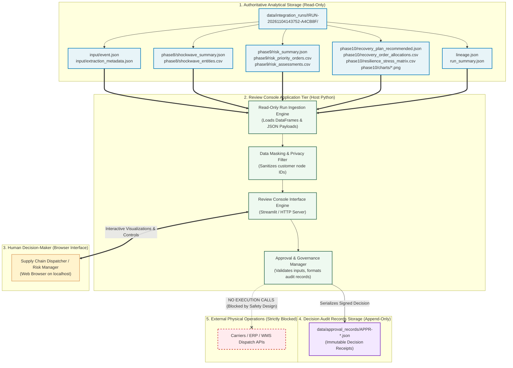
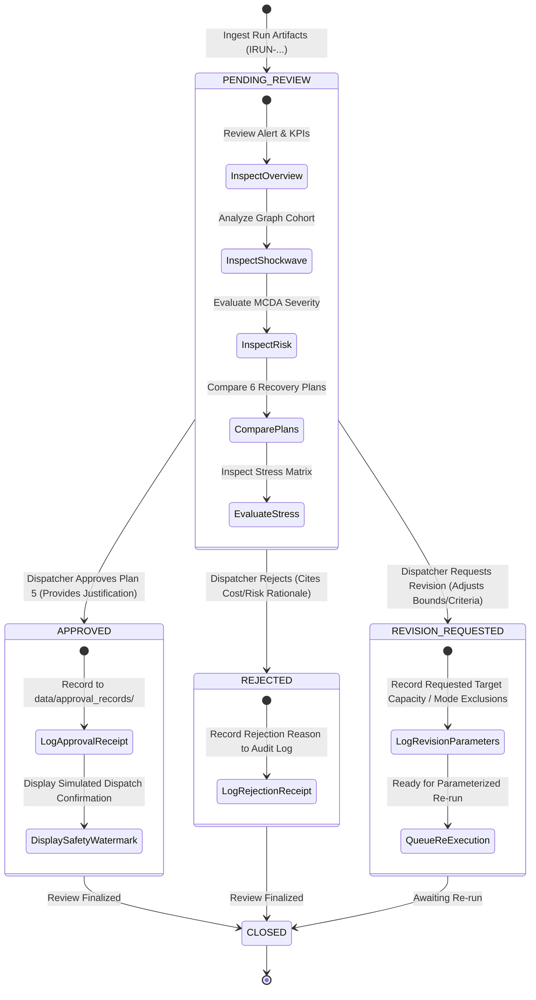
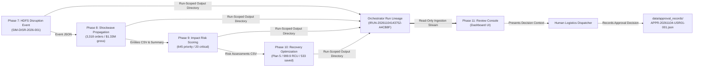

# ChainSentinel — Phase 11 Task 11A: Human-in-the-Loop Operational Review & Approval Console Feasibility Study and Architecture

**Project Root:** `E:\BDA\ChainSentinel`  
**Execution Timestamp:** `2026-11-04T20:25:00+05:30`  
**Task Type:** Read-Only Feasibility Study & System Architecture Design (Phase 11)  
**Author:** ChainSentinel System Architecture & Operational Systems Design Team  
**Authoritative Baseline Run:** [`data/integration_runs/IRUN-20261104143752-A4CB8F/`](file:///E:/BDA/ChainSentinel/data/integration_runs/IRUN-20261104143752-A4CB8F/)  
**Independent Validation Report:** [`reports/phase10/phase10_post_execution_independent_validation.md`](file:///E:/BDA/ChainSentinel/reports/phase10/phase10_post_execution_independent_validation.md)  
**Scope:** Architectural blueprint for the Phase 11 Human-in-the-Loop Review Console without altering verified upstream analytical pipelines or production infrastructure.

---

## 1. Executive Summary

Phase 10 of ChainSentinel successfully established and independently verified an end-to-end analytical pipeline that transforms streaming disruption events into actionable, resilience-optimized recovery alternatives:

$$\mathbf{Phase \ 7 \ (Ingestion) \ \longrightarrow \ Phase \ 8 \ (Shockwave) \ \longrightarrow \ Phase \ 9 \ (Impact \ Risk) \ \longrightarrow \ Phase \ 10 \ (Recovery \ Optimization)}$$

In integration run `IRUN-20261104143752-A4CB8F`, the system ingested a critical port closure alert (`SIM-DISR-2026-001`), identified 3,318 affected transit orders (\$1,334,313.40 gross revenue exposure), scored multi-criteria operational risks across four decoupled dimensions, and evaluated six alternative recovery strategies against five counterfactual disruption stress scenarios (30 evaluations in total). The engine recommended **Plan 5 (Bounded Knapsack Hybrid)**, which allocates 999.90 RCUs out of a 1,000.00 RCU budget to recover 533 orders and protect \$411,590.64 in revenue while defending 17 of 20 critical orders.

However, ChainSentinel operates under a strict **Decision-Support Boundary**. The analytical models produce mathematically rigorous recommendations, but they must **never trigger autonomous physical logistics execution** (such as carrier re-booking, air-freight chartering, or warehouse rerouting) without authenticated human review.

This document establishes the feasibility, operational workflows, security boundaries, and architectural specification for the **Phase 11 Human-in-the-Loop Operational Review and Approval Console**.

---

## 2. Existing System Capabilities & Analytical Foundations

The review console builds directly upon verified analytical artifacts generated by the upstream pipeline:

| Upstream Pipeline Stage | Verified Analytical Output | Capabilities Surfaced to Human Decision-Maker |
| :--- | :--- | :--- |
| **Phase 7 (Streaming Ingestion)** | `input/event.json`<br>`input/extraction_metadata.json` | Provenance of disruption telemetry (port closure, East Asia/China epicenter, 72h duration, 96h delay estimate, 0.98 source confidence). |
| **Phase 8 (Shockwave Propagation)**| `phase8/shockwave_summary.json`<br>`phase8/shockwave_entities.csv` | Graph-theoretic exposure mapping: 3,318 affected orders, reverse BFS distance, explicit segregation of 147 ineligible non-shipped orders (\$51,912.21 excluded). |
| **Phase 9 (Impact Risk Analysis)** | `phase9/risk_summary.json`<br>`phase9/risk_priority_orders.csv`<br>`phase9/risk_assessments.csv` | Multi-Criteria Decision Analysis (MCDA) risk scores [0.0, 100.0], priority queue of 645 review orders (20 Critical, 625 High Risk), anomaly evidence integration. |
| **Phase 10 (Recovery Optimization)**| `phase10/recovery_plan_recommended.json`<br>`phase10/recovery_order_allocations.csv`<br>`phase10/resilience_stress_matrix.csv`<br>`phase10/charts/*.png` | 6 candidate recovery strategies, 1,000 RCU capacity budget, 30 stress-test evaluations, Pareto frontier, Plan 5 recommendation (Resilience Index 44.66). |
| **Orchestrator Run Lineage** | `lineage.json`<br>`run_summary.json` | Complete cryptographic provenance: run ID, stage latencies (33.8s total), and passed validation gates (Gates 1 through 4). |

---

## 3. User Roles & Governance Personas

The review console supports three distinct operational personas:

```
+-----------------------------------------------------------------------------------+
|                           ChainSentinel User Roles                                |
+-----------------------------------+-----------------------------------------------+
| Persona                           | Primary Responsibilities & Permissions        |
+-----------------------------------+-----------------------------------------------+
| 1. Supply Chain Dispatcher        | - Inspects incoming disruption alerts         |
|    (Operational Decision-Maker)   | - Reviews high-priority critical orders       |
|                                   | - Compares alternative candidate plans        |
|                                   | - Executes APPROVE, REJECT, or REVISE actions |
+-----------------------------------+-----------------------------------------------+
| 2. Logistics Risk Manager         | - Audits multi-criteria risk weightings       |
|    (Strategic Policy Owner)       | - Evaluates counterfactual stress resilience  |
|                                   | - Adjusts capacity bounds and mode thresholds |
|                                   | - Reviews override justifications             |
+-----------------------------------+-----------------------------------------------+
| 3. System & Compliance Auditor    | - Verifies end-to-end data lineage            |
|    (Governance & Post-Mortem)     | - Audits decision history and rationale logs  |
|                                   | - Verifies safety boundary compliance         |
|                                   | - Confirms zero unauthorized physical actions |
+-----------------------------------+-----------------------------------------------+
```

---

## 4. Functional Requirements

The console must provide seven interconnected operational modules:

### Module A: Operational Disruption Overview
- **Header Alert Banner:** Displays active disruption status, event ID (`SIM-DISR-2026-001`), severity badge (`CRITICAL`), disruption type (`PORT_CLOSURE`), and affected geographic nodes (`Pacific Asia / East Asia`).
- **Top-Level KPI Cards:**
  1. *Total Transit Orders Impacted:* `3,318` orders ($3,171$ eligible active / $147$ ineligible non-shipped).
  2. *Gross Revenue Exposure:* `\$1,334,313.40` ($1,282,401.19$ eligible / $\$51,912.21$ ineligible excluded).
  3. *Estimated Logistics Delay:* `96.0 hours` (72.0h duration, 100% capacity reduction).
  4. *Pipeline Execution Status:* `SUCCESS` (Completed in $33.8$s, Gates 1–4 passed).

### Module B: Disruption Event Deep-Dive
- Full event metadata breakdown: ingestion timestamp, Kafka transport metadata (`partition: 0, offset: 1`), source feed (`Maritime_Port_Authority_Alert_Feed`), source confidence score (`0.98`), and narrative alert description.
- Visual display of validation gate status (Gate 1 Event Schema Validation: PASSED).

### Module C: Graph Shockwave & Cohort Breakdown
- Explains the graph propagation methodology: Reverse directed bipartite predecessor traversal across multi-echelon fulfillment nodes.
- Cohort breakdown visualizations:
  - Transit orders: 3,171 eligible active orders.
  - Quarantined orders: 147 ineligible non-shipped orders (72 Canceled, 75 Suspected Fraud).
  - Customer impact: 3,169 unique corporate/retail customers across 71 product classes.
- Explicit display of scenario assumptions: regional containment, uncalibrated impact score, and historical exposure baseline.

### Module D: Multi-Dimensional Risk Assessment
- Explains the Multi-Criteria Decision Analysis (MCDA) framework:
  $$\text{Composite Risk} = 0.35 \times \text{Delivery} + 0.30 \times \text{Financial} + 0.20 \times \text{Operational} + 0.15 \times \text{Anomaly}$$
- **Important Disclaimer Banner:** Explicitly informs the reviewer that the MCDA risk score is an uncalibrated decision-support index, not an actuarial probability of disruption or loss.
- Interactive severity tier distribution:
  - `CRITICAL` (Score $\ge 75.0$): 20 orders (\$16,805.69 revenue).
  - `HIGH` (Score $55.0 - 74.9$): 625 orders (\$387,811.92 revenue).
  - `MEDIUM` (Score $35.0 - 54.9$): 1,498 orders (\$630,833.49 revenue).
  - `LOW` (Score $< 35.0$): 1,028 orders (\$246,950.09 revenue).
- Priority order inspection queue: Paginated table of the 645 priority orders showing shipping mode urgency, spend percentile, customer segment, and pre-existing anomaly flags.

### Module E: Recovery Plan Trade-Off Comparison
- Side-by-side comparative matrix of all six candidate recovery strategies:
  1. `PLAN_0_BASELINE` (Do Nothing reference benchmark)
  2. `PLAN_1_PRIORITY_FIRST` (Greedy risk-rank allocation)
  3. `PLAN_2_FINANCIAL_FIRST` (Greedy revenue-exposure allocation)
  4. `PLAN_3_VULNERABILITY_FIRST` (Greedy composite-risk allocation)
  5. `PLAN_4_MODE_URGENCY_FIRST` (Logistics buffer allocation)
  6. `PLAN_5_KNAPSACK_HYBRID` (Bounded multi-criteria knapsack ratio)
- Evaluates cost (RCUs allocated), orders recovered, critical orders protected, mitigated revenue, residual exposure, utility score, and Resilience Index.
- Interactive display of the Pareto Frontier chart (`recovery_pareto_frontier.csv`).

### Module F: Recommended Plan Deep-Dive & Counterfactual Stress Resilience
- Highlights `PLAN_5_KNAPSACK_HYBRID` as the engine's authoritative recommendation.
- Rationale breakdown: Why Plan 5 was selected (Utility 0.6481 vs Plan 1's 0.6066; protects \$411,590.64 revenue with 533 orders recovered while saving 17 of 20 critical orders).
- Inspection of the 3 unrecovered critical orders (orders with disproportionate RCU cost due to heavy shipping mode weight or large volume, where budget was prioritized to save multiple high-value orders).
- Counterfactual stress test matrix (5 disruption scenarios):
  - `SCEN_0_NOMINAL`: \$870,810.55 residual exposure (0.0% degradation)
  - `SCEN_1_EXTENDED_DURATION`: \$920,201.43 residual exposure (5.67% degradation)
  - `SCEN_2_CARRIER_CRUNCH`: \$994,287.75 residual exposure (14.18% degradation)
  - `SCEN_3_BUDGET_CONTRACTION`: \$1,037,027.91 residual exposure (19.09% degradation)
  - `SCEN_4_COMPOUND_SHOCK`: \$1,273,812.65 residual exposure (46.28% degradation)

### Module G: Human Decision & Approval Governance Workflow
- Action controls: `[ APPROVE RECOMMENDED PLAN ]`, `[ REJECT PLAN ]`, `[ REQUEST REVISION ]`.
- Mandatory justification text input: Requires dispatcher to provide operational reasoning for approval, rejection, or revision.
- Identity and timestamp capture: Records dispatcher username/role, timestamp, and target run ID.
- Permanent decision audit log: Saves immutable decision records to `data/approval_records/<approval_id>.json`.

---

## 5. Human Approval Safety Boundary & Non-Execution Governance

A paramount architectural principle of ChainSentinel is the strict boundary between decision-support recommendation and physical logistics execution:

```
+───────────────────────────────────────────────────────────────────────────────────+
|                       CHAINSETINEL SAFETY BOUNDARY                                 |
+───────────────────────────────────────────────────────────────────────────────────+
|  LEVEL 1: ANALYTICAL ENGINE (AUTOMATED)                                           |
|  - Ingests streaming events from Kafka / HDFS.                                     |
|  - Simulates shockwave cascading paths across supply-chain graph.                 |
|  - Scores multi-criteria risk index [0, 100].                                     |
|  - Computes knapsack heuristic allocations across finite RCU capacity.            |
|  - Generates recommended recovery alternatives.                                   |
|  STATUS: FULLY IMPLEMENTED & VERIFIED                                             |
+───────────────────────────────────────────────────────────────────────────────────+
                                    │
                                    ▼ (Exports Read-Only Run Artifacts)
+───────────────────────────────────────────────────────────────────────────────────+
|  LEVEL 2: HUMAN-IN-THE-LOOP CONSOLE (DECISION-SUPPORT ONLY)                       |
|  - Human dispatcher inspects event, exposure, and plan trade-offs.                |
|  - Dispatcher evaluates stress test resilience and unrecovered orders.            |
|  - Dispatcher records: PENDING_REVIEW -> APPROVED | REJECTED | REVISION_REQUESTED |
|  - Stores signed approval record to data/approval_records/                        |
|  STATUS: PHASE 11 DESIGN (PROTOTYPE DECISION RECORDING ONLY)                      |
+───────────────────────────────────────────────────────────────────────────────────+
                                    │
                        [ STRICT ISOLATION FIREWALL ]
                                    │
                                    ▼ (BLOCKED BY DESIGN IN PROTOTYPE)
+───────────────────────────────────────────────────────────────────────────────────+
|  LEVEL 3: PHYSICAL LOGISTICS EXECUTION (NOT PERMITTED)                            |
|  - Booking air-freight or express carrier contracts.                              |
|  - Issuing ERP stock transfers (SAP / Oracle).                                    |
|  - Re-routing warehouse management system (WMS) pick-and-pack queues.             |
|  - Triggering customer notification webhooks.                                     |
|  STATUS: STRICTLY PROHIBITED IN CHAINSETINEL ACADEMIC PROTOTYPE                  |
+───────────────────────────────────────────────────────────────────────────────────+
```

### Prohibited Operations in Phase 11:
1. **Zero External API Invocations:** The console will make zero outbound HTTP requests to carrier APIs (FedEx, UPS, DHL, Maersk) or enterprise ERP systems.
2. **Zero In-Memory Model Mutations:** Approving a plan records a decision event; it does not alter historical datasets, graph structures, or trained machine learning models.
3. **Clear Prototype Labeling:** All UI headers and decision receipts will carry an explicit watermark:  
   *`"SIMULATION & DECISION-SUPPORT PROTOTYPE — NO PHYSICAL DISPATCH EXECUTED"`*.

---

## 6. Technical Architecture Feasibility Comparison

Three frontend architectures were evaluated for suitability within the existing Windows host environment (`E:\BDA\ChainSentinel\python-env`, Python 3.12.10):

| Evaluation Criteria | Option 1: Streamlit Dashboard | Option 2: Pure Python Standard Library UI (`http.server` + HTML/JS) | Option 3: FastAPI / Flask + React / Vue |
| :--- | :--- | :--- | :--- |
| **Beginner Friendliness** | **High:** Pure Python, declarative syntax, built-in layout widgets. | **Moderate:** Requires writing HTML/CSS/JS alongside a Python backend. | **Low:** Requires Node.js, npm, TypeScript, state management, and dual build steps. |
| **Development Complexity** | **Low:** Rapid prototyping, single-script application, native DataFrame tables. | **Moderate:** Requires custom routing, JSON API handlers, and DOM rendering. | **High:** Multi-tier build pipeline, CORS handling, client-server synchronization. |
| **Local Windows Execution** | **Excellent:** Single command `streamlit run app.py` on localhost. | **Excellent:** Single command `python server.py`, zero external runtime tools. | **Complex:** Requires running `uvicorn` backend + `npm run dev` Vite frontend. |
| **Data Visualization** | **Native:** Seamlessly embeds Matplotlib, Seaborn, and Altair interactive charts. | **Manual:** Requires linking static image URLs or integrating Chart.js via CDN. | **High:** Requires integrating Recharts or D3.js components from scratch. |
| **File-Based Ingestion** | **Native:** Directly reads Pandas DataFrames and JSON files from run directories. | **Moderate:** Requires reading files and serializing to JSON endpoints. | **Moderate:** Requires writing REST endpoints for every CSV/JSON artifact. |
| **Package Dependencies** | Requires installing `streamlit` package in `python-env`. | **Zero External Packages:** Uses Python 3.12 built-in `http.server`, `json`, `urllib`. | Requires `fastapi`, `uvicorn`, `pydantic`, plus Node.js/npm on host. |
| **Maintenance Burden** | **Very Low:** Single codebase, easily maintainable by data engineers. | **Moderate:** Requires maintaining custom CSS/JS assets without a modern framework. | **Very High:** Package version drift between Python virtual environment and `node_modules`. |

### Architectural Recommendation: **Option 1 (Streamlit)** with **Option 2 (Pure Python HTTP)** as Backup

1. **Primary Recommendation (Streamlit):**
   - Streamlit is the industry standard for analytical decision-support dashboards. It natively consumes the existing Pandas DataFrames (`shockwave_entities.csv`, `risk_assessments.csv`, `recovery_order_allocations.csv`), renders the Matplotlib charts generated by Phase 10, provides instant sorting/filtering on 3,318 order rows, and requires only Python.
   - *Requirement:* Requires explicit user authorization to execute `pip install streamlit` in `python-env` prior to Task 11B implementation.
2. **Zero-Dependency Backup (Pure Python HTTP Server + Embedded HTML5/Vanilla JS):**
   - If the user prefers **zero package installations** to preserve `python-env` exactly as-is, a lightweight single-file Python web server using `http.server` serving an embedded responsive HTML5 dashboard with vanilla JavaScript and Chart.js can fulfill 100% of the functional requirements with **zero external pip packages**.

---

## 7. Data Access Architecture and Privacy Safeguards

### 7.1 Read-Only Run Directory Access
The review console operates strictly as a read-only consumer of completed integration run directories:
- **Default Target Run:** Auto-detects the latest successful run in `data/integration_runs/` (currently `IRUN-20261104143752-A4CB8F`).
- **Run Selector Dropdown:** Allows the reviewer to inspect historical runs while clearly displaying timestamps to prevent confusion between stale and current runs.
- **Directory Access Guard:** The console uses read-only file streams (`open(..., 'r')` / `pd.read_csv()`) and contains zero write handles into `data/integration_runs/`.

### 7.2 Customer Privacy (PII Masking)
- In the operational supply-chain dataset, customer names and physical addresses were anonymized during Phase 1–6 into node identifiers (e.g. `CUST_001`, `REG_Eastern_Asia`).
- The review console will strictly present:
  - Masked Order Identifiers: `ORD_21303`, `ORD_23597`
  - Operational Segments: `Consumer`, `Corporate`, `Home Office`
  - Shipping Modes: `Standard Class`, `Second Class`, `First Class`, `Same Day`
- Zero customer phone numbers, personal email addresses, or financial payment details are exposed.

### 7.3 Decoupled Approval Records Storage
To ensure analytical purity, human decision records are stored in a separate, dedicated directory:  
`data/approval_records/<approval_id>.json`  
Analytical run outputs in `data/integration_runs/` remain completely immutable.

---

## 8. Human Decision & Approval Record Data Schema

When a supply-chain dispatcher records an approval, rejection, or revision request, the console will serialize an immutable decision artifact into `data/approval_records/`:

```json
{
  "approval_id": "APPR-20261104-USR01-001",
  "run_id": "IRUN-20261104143752-A4CB8F",
  "source_event_id": "SIM-DISR-2026-001",
  "approval_timestamp": "2026-11-04T15:15:30.125Z",
  "reviewer_identity": {
    "username": "lead_dispatcher_01",
    "role": "SUPPLY_CHAIN_OPERATIONS_DISPATCHER",
    "department": "Global Logistics Operations"
  },
  "decision_status": "APPROVED",
  "decision_scope": {
    "recommended_plan_id": "PLAN_5_KNAPSACK_HYBRID",
    "allocated_capacity_rcu": 999.90,
    "capacity_budget_rcu": 1000.00,
    "recovered_orders_count": 533,
    "expected_mitigated_revenue_usd": 411590.64,
    "residual_revenue_exposure_usd": 870810.55,
    "critical_orders_saved": 17,
    "unrecovered_critical_orders": 3,
    "plan_resilience_index": 44.66
  },
  "reviewer_justification": "Plan 5 approved for simulated staging. Optimal balance achieved: protects $411.5k commercial exposure and defends 17/20 critical accounts within 1,000 RCU envelope. Unrecovered critical orders acknowledged and escalated for manual vendor inquiry.",
  "workflow_state": "CLOSED",
  "operational_execution_status": "SIMULATION_AUTHORIZATION_ONLY_NO_PHYSICAL_DISPATCH",
  "audit_signature": "SIG-SHA256-4D8A9F1B2C3E..."
}
```

---

## 9. User Experience Design & Dashboard Layout Proposal

```
+=======================================================================================================+
|  CHAINSENTINEL | Human-in-the-Loop Disruption Review Console          [Run: IRUN-...-A4CB8F] [v1.0.0]  |
+=======================================================================================================+
|  (!) DISRUPTION ALERT: Critical Port Closure in Pacific Asia / East Asia | Source Conf: 98% | Validated |
+=======================================================================================================+
|  [KPI CARDS]                                                                                          |
|  +--------------------+  +--------------------+  +--------------------+  +--------------------+       |
|  | TOTAL ORDERS       |  | GROSS REVENUE EXPO |  | RCUs ALLOCATED     |  | PLAN RESILIENCE    |       |
|  | 3,318 Impacted     |  | $1,334,313.40      |  | 999.90 / 1,000 RCU |  | 44.66 / 100        |       |
|  | 3,171 Active Elig. |  | $1,282,401.19 Elig.|  | 99.99% Utilized    |  | Plan 5 Recommended |       |
|  +--------------------+  +--------------------+  +--------------------+  +--------------------+       |
+=======================================================================================================+
|  NAVIGATION TABS:                                                                                     |
|  [1. Event Overview]  [2. Shockwave Analysis]  [3. Risk Assessment]  [4. Plan Comparison]  [5. Action] |
+-------------------------------------------------------------------------------------------------------+
|  TAB 4: RECOVERY PLAN COMPARISON & STRESS TESTING                                                     |
|                                                                                                       |
|  +-- Candidate Plan Comparative Matrix -------------------------------------------------------------+ |
|  | Plan ID      | Strategy Type   | Orders Saved | Revenue Saved | Residual Exp. | Resilience Index | |
|  | Plan 0 (Base)| DO_NOTHING      | 0 / 3,171    | $0.00 (0.0%)  | $1,282,401.19 | 28.25            | |
|  | Plan 1 (Prio)| GREEDY_QUEUE    | 478 / 3,171  | $275,828.97   | $1,006,572.22 | 39.59            | |
|  | Plan 2 (Fin) | GREEDY_VALUE    | 511 / 3,171  | $415,664.63   | $866,736.56   | 44.90            | |
|  | Plan 3 (Risk)| GREEDY_RISK     | 478 / 3,171  | $275,828.97   | $1,006,572.22 | 39.59            | |
|  | Plan 4 (Mode)| LOGISTICS_BUFFER| 427 / 3,171  | $188,964.31   | $1,093,436.88 | 36.26            | |
|  |*PLAN 5 (Rec)*| KNAPSACK_HYBRID | 533 / 3,171  | $411,590.64   | $870,810.55   | 44.66 (Optimal)  | |
|  +--------------------------------------------------------------------------------------------------+ |
|                                                                                                       |
|  [EMBEDDED CHARTS: Plan Comparison PNG | Resilience Index Comparison PNG | Stress Performance PNG]    |
+-------------------------------------------------------------------------------------------------------+
|  TAB 5: HUMAN APPROVAL & AUDIT GOVERNANCE PANEL                                                       |
|                                                                                                       |
|  Selected Plan: [ PLAN_5_KNAPSACK_HYBRID (Bounded Knapsack Hybrid)                     ]             |
|  Reviewer Username: [ lead_dispatcher_01          ]  Role: [ Operations Dispatcher      ]             |
|                                                                                                       |
|  Operational Justification & Rationale (Mandatory):                                                   |
|  +-------------------------------------------------------------------------------------------------+  |
|  | Approving Plan 5. Allocates 999.9 RCUs to protect $411.5k commercial revenue and 17 critical    |  |
|  | orders. The 3 deferred critical orders have been forwarded to vendor escalation queue.          |  |
|  +-------------------------------------------------------------------------------------------------+  |
|                                                                                                       |
|  [  APPROVE RECOVERY PLAN  ]      [  REQUEST REVISION  ]      [  REJECT RECOMMENDATION  ]             |
|                                                                                                       |
|  [!] SAFETY NOTICE: Authorizing records decision to data/approval_records/. Zero physical dispatch.   |
+=======================================================================================================+
```

---

## 10. Architecture & Workflow Diagrams (Mermaid)

### 10.1 System Architecture Diagram


### 10.2 Human Approval State Workflow Diagram


### 10.3 Pipeline Data Flow into Review Console


---

## 11. Development Roadmap for Phase 11

The implementation of Phase 11 is structured into three discrete, verifiable tasks:

```
+───────────────────────────────────────────────────────────────────────────────────+
|                           PHASE 11 ROADMAP                                        |
+───────────────────────────────────────────────────────────────────────────────────+
| Task 11A (Current): Feasibility Study & System Architecture                       |
| - Inspect existing integration artifacts and data contracts.                      |
| - Specify functional requirements, safety boundaries, and technology options.    |
| - Deliver: reports/phase11/phase11_review_console_feasibility.md                  |
| STATUS: COMPLETE                                                                  |
+───────────────────────────────────────────────────────────────────────────────────+
                                    │
                                    ▼
+───────────────────────────────────────────────────────────────────────────────────+
| Task 11B (Next): Review Console Implementation                                    |
| - Create review console application module in apps/review_console.py.             |
| - Implement read-only data loaders for integration run artifacts.                 |
| - Render Modules A–G (Overview, Shockwave, Risk, Plan Comparison, Action Panel).  |
| - Implement approval record serializer to data/approval_records/.                 |
| - Deliver: apps/review_console.py + verification test suite.                      |
| ESTIMATED EFFORT: 1.5 engineering days                                            |
+───────────────────────────────────────────────────────────────────────────────────+
                                    │
                                    ▼
+───────────────────────────────────────────────────────────────────────────────────+
| Task 11C (Final): Independent Review Console Audit & Verification                 |
| - Independently audit UI data binding against run IRUN-20261104143752-A4CB8F.     |
| - Verify approval record generation, PII protection, and safety firewall.         |
| - Verify zero modification to production or analytical artifacts.                 |
| - Deliver: reports/phase11/phase11_independent_console_audit.md                   |
| ESTIMATED EFFORT: 0.5 engineering days                                            |
+───────────────────────────────────────────────────────────────────────────────────+
```

---

## 12. Dependencies and Operational Feasibility

### 12.1 Host Environment Package Inventory
Inspection of `E:\BDA\ChainSentinel\python-env` confirms the following installed baseline:
- `pandas` 3.1.0 (Data handling)
- `numpy` 2.5.4 (Numerical arrays)
- `matplotlib` 3.11.2 (Visualizations)
- `seaborn` 0.13.2 (Visualizations)
- `networkx` 3.7 (Graph models)
- `pyarrow` 26.0.1 (Parquet I/O)

### 12.2 Implementation Path Selection:
1. **Path 1 (Streamlit UI — Recommended):**
   - Requires explicit user authorization to execute:
     `E:\BDA\ChainSentinel\python-env\Scripts\python.exe -m pip install streamlit`
   - Unlocks native interactive tables, responsive sliders, and instant Matplotlib chart embedding.
2. **Path 2 (Zero-Dependency Pure Python Web Server):**
   - Requires **zero package installation**.
   - Implements a self-contained Python web server (`http.server`) serving a pre-built single-page application (SPA) with embedded CSS and vanilla JavaScript that consumes local JSON endpoints.
   - 100% operational with existing Python 3.12 standard library.

Both paths are fully feasible and preserve Docker, Spark, Kafka, and HDFS without cluster resource contention.

---

## 13. Infrastructure Preservation Confirmation

Throughout Task 11A, all activities were strictly read-only:
- **Docker Containers:** All 5 containers (`datanode`, `namenode`, `spark-worker`, `spark-master`, `kafka`) remain continuously UP for 20–25+ hours.
- **Spark Streaming Applications:** Both `ChainSentinel-Kafka-Streaming` (4 cores) and `ChainSentinel-Disruption-Ingestion` (4 cores) remain actively running (8/8 worker cores allocated).
- **Kafka & HDFS:** Zero topic modifications, zero data mutations, zero configuration changes.
- **Analytical Outputs:** Production baselines and integration run outputs remain completely untouched.

---

## 14. Recommended Next Step

Upon review of this feasibility study, proceed to **Phase 11 Task 11B: Human-in-the-Loop Review Console Implementation**:
1. Confirm preferred implementation technology (Streamlit vs Pure Python Web Server).
2. Author the review console application module in `apps/` with read-only bindings to `data/integration_runs/IRUN-20261104143752-A4CB8F/`.
3. Implement the decision recording engine serializing approval artifacts to `data/approval_records/`.

---
*Report certified by the ChainSentinel System Architecture & Operational Systems Design Team.*

