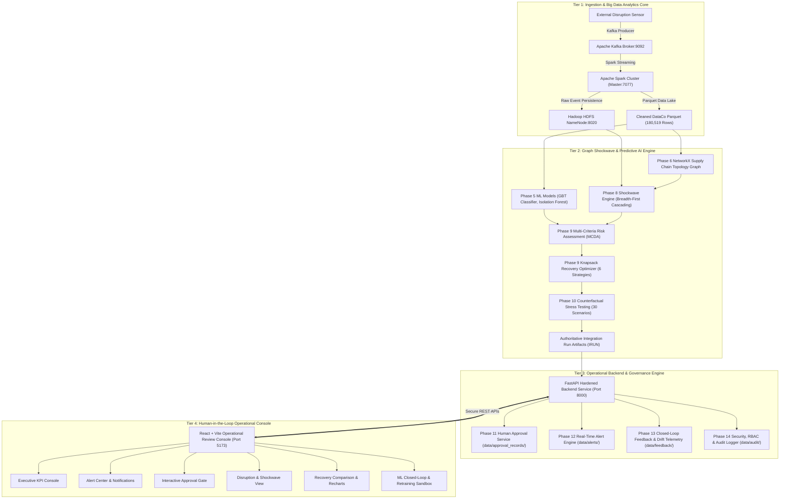
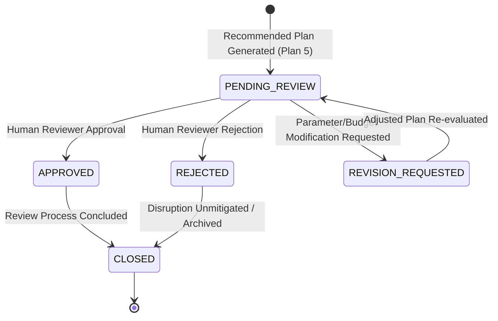
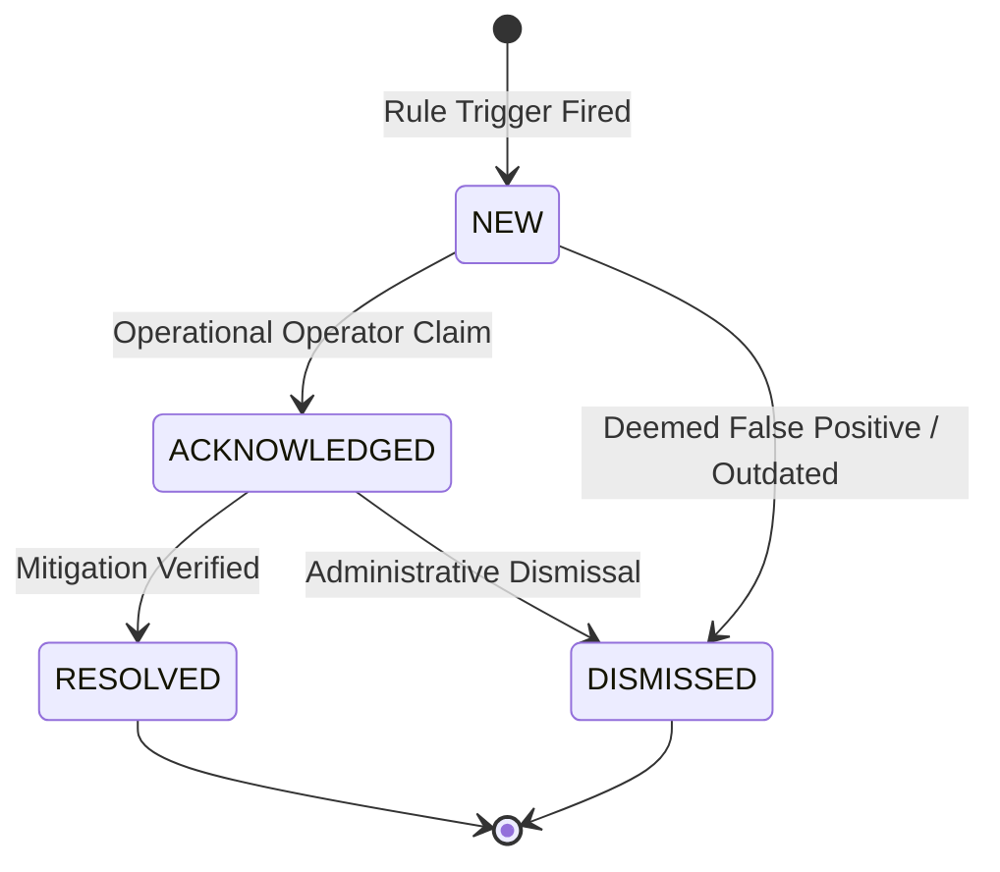
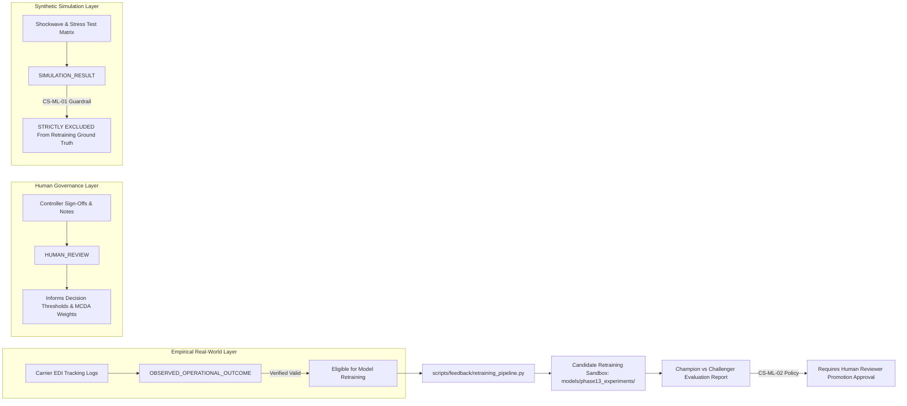

# ChainSentinel — Phase 15 Task 15B: End-to-End System Architecture
## Comprehensive Technical Architecture, Data Flows, and System Design

**Document Reference:** `reports/phase15/phase15_system_architecture.md`  
**Execution Timestamp:** 2026-11-04T23:41:00+05:30  
**Status:** COMPLETE — ARCHITECTURE SPECIFICATION AUTHORITATIVE  
**Authoritative Run ID:** `IRUN-20261104143752-A4CB8F`  
**Disruption Event ID:** `SIM-DISR-2026-001`  

---

## 1. System Overview

**ChainSentinel** is a graph-aware supply chain disruption and resilience decision-support engine. It ingests real-time external disruption events, models their cascading topological shockwave across a multi-tier supply network, evaluates order risk cohorts via Multi-Criteria Decision Analysis (MCDA), synthesizes optimal resource allocation recovery strategies via knapsack optimization, subjects candidate plans to counterfactual stress testing, and presents actionable recommendations through a secured human-in-the-loop operational review console.

---

## 2. Global Component Architecture

---

## 3. Streaming Flow & Storage Design

### 3.1 Streaming Architecture
1. **Disruption Producer:** Ingests external sensor events (e.g. port closures, natural disasters, supplier strikes) formatted to strict JSON schema.
2. **Kafka Topic (`chainsentinel.disruptions`):** Retains event stream with partition key on origin country / facility.
3. **Spark Structured Streaming Consumer:** Consumes micro-batches with 5-second trigger intervals, validating JSON schema and writing immutable event receipts into HDFS at `hdfs://namenode:8020/chainsentinel/disruptions/raw_events/`.

### 3.2 Storage Hierarchy
- **Raw Parquet Lake:** `data/processed/dataco_cleaned.parquet` (180,519 records, 53 schema attributes).
- **Graph Topology:** `data/graph/` serialized NetworkX graph format.
- **Integration Runs:** `data/integration_runs/<RUN_ID>/` containing frozen snapshot outputs:
  - `phase7_disruption_event.json`
  - `phase8_shockwave_result.json`
  - `phase9_risk_assessment.json`
  - `phase9_recovery_plans.json`
  - `phase9_recommended_plan.json`
  - `phase10_stress_test_matrix.json`
  - `execution_lineage.json`
- **Governance Receipts:**
  - `data/approval_records/APPR-*.json` (Append-only human decisions)
  - `data/alerts/ALERT-*.json` (Audited alert lifecycles)
  - `data/feedback/FEEDBACK-*.json` (Epistemologically governed feedback records)
  - `data/audit/audit_log.jsonl` (Centralized structured security audit log)

---

## 4. Human Approval & Alert State Machines

### 4.1 Approval Workflow State Machine

### 4.2 Alert Lifecycle State Machine

---

## 5. Epistemological ML Closed-Loop Architecture

---

## 6. Security & Hardening Boundaries (Phase 14)

- **Authentication:** Local PBKDF2-HMAC-SHA256 (100,000 iterations) with salted hashes.
- **Session Tokens:** 256-bit CSPRNG tokens (`secrets.token_hex(32)`) with 60-minute lifetime.
- **RBAC:** Three roles: `VIEWER` (read-only), `REVIEWER` (approvals and alert actions), `ADMIN` (retraining and system governance).
- **Defensive Headers:** Automatic injection of `nosniff`, `DENY` frames, `Referrer-Policy`, and rate limiting headers.
- **Rate Limiting:** Sliding-window in-memory limiter enforcing max 180 requests/min per IP.
- **Path Traversal Defense:** Strict rejection of `..`, `/`, `\`, and null bytes on all path parameters.

---

## 7. Architecture Summary & Boundaries

ChainSentinel enforces strict operational decoupling:
1. Analytical and Big Data processing operates in isolated pipelines without mutating base datasets.
2. The web layer is purely decision-support; **no physical dispatch, carrier API call, or ERP financial transaction is executed**.
3. All actions generate immutable, cryptographically verifiable local receipts.

